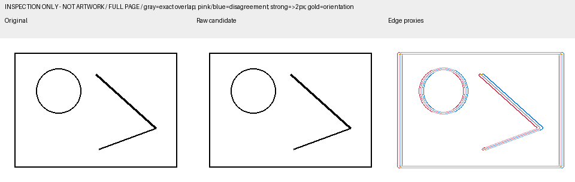

# Manga Colorization · 漫画上色

**给现有漫画上色，保留原画、文字和演出，让角色与道具的配色跨页一致。**

[English](README.en.md) · [快速开始](docs/getting-started.md) · [使用示例](examples/README.md) · [工具说明](docs/tools.md) · [问题反馈](https://github.com/phonowell/manga-colorization/issues)

[](https://github.com/phonowell/manga-colorization/actions/workflows/validate.yml)
[](LICENSE)
[](https://agentskills.io)

这是一个交给 AI agent 使用的 **skill 与本地校审工具包**。上色需要你的 agent 能调用支持原图与参考图的生图工具；本仓库负责工作方法、配色连续性、返工和可追溯核看。你保留选版和创作控制权。

## 安装

需要 Node.js 22.20+。在漫画项目目录运行，安装到当前项目：

```sh
npx skills add phonowell/manga-colorization --skill manga-colorization -a codex
```

其他兼容 agent 可通过安装器选择，例如把 `codex` 换成 `claude-code`。需要在所有项目使用时加 `-g`。安装器兼容不代表已完成每个 agent 的上色实测；见[兼容性与安装](docs/getting-started.md#安装与兼容性)。不使用 Node.js 时，也可手动复制技能目录。

开启新会话并输入：

```text
使用 $manga-colorization 给 ./originals/page-01.png 上色。
参考 ./references/ 中的彩图，采用明亮通透的水彩风格。
保留原稿的文字、表情、手势和分格。
先处理这一页，核看后交给我选版；不要直接批量处理整章。
```

开始前准备好**黑白原稿**；有官方彩图、前页选版或指定配色时一并提供。第一次使用不必先手写一套 Colorleaf 账本。详细步骤见[完成第一张页面](docs/getting-started.md#完成第一张页面)。

## 能帮你做什么

| 场景 | 你提供 | 工作方式 |
| --- | --- | --- |
| 第一页上色 | 原稿、风格，有则提供配色参考 | 核对原稿，生成候选，逐项核看后交你选版 |
| 连续页面 | 本页原稿、前页选版、角色或道具配色 | 延续已确认身份色，记录光照与服装状态变化 |
| 局部返工 | 原稿、被审核版本、具体反馈 | 汇总仍有效反馈，用原稿整页或完整分格重新生成 |
| 多候选选优 | 原始候选与各自来源 | 选择合格的完整分格拼回，再复核最终整页 |
| 画质校审 | 原稿、实际交付候选 | 分别检查保真、语义归属、连续性、完整性与观感 |

## 先试试本地工具

不需要 API key 或漫画文件。克隆后安装 Python 3.10+ 依赖，运行几何测试图诊断：

```sh
git clone https://github.com/phonowell/manga-colorization.git
cd manga-colorization
python -m pip install -r requirements.txt
python scripts/quickstart.py --demo --out outputs/first-demo
```

打开 `outputs/first-demo/inspection/contact-sheet.png` 和 `outputs/first-demo/fidelity/comparison/overview-inspection.png`。



*这张图来自离线几何测试图，只演示偏移定位与诊断输出，不代表漫画上色效果。没有模型请求，诊断不会自动批准画质。*

换成你已有的原稿与同尺寸候选：

```sh
python scripts/quickstart.py --source original.png --candidate candidate.png --out outputs/my-review
```

工具不修改输入、不自动对齐，也不覆盖旧核看目录。报告含本地路径，分享前应检查。更多参数见[工具说明](docs/tools.md)。

## 保留什么，如何返工

- 黑白原稿决定结构。彩图只作配色参考，下一轮仍从原稿生成。
- 物体上色和漏色、串色修正由生图模型完成；代码不直接给物体涂色。
- 允许多候选、完整分格拼版、拆回与选优拼接，以及整格统一调色；保留来源 SHA 与坐标。
- 文字、表情、眼形和手势需要逐项核看，不能用整页平均分掩盖局部改变。
- 技术检查、agent 的画质判断和你的批准分别记录。

## 常见问题

**安装后就能生图吗？** 需要你自己的已授权生图工具，支持原图输入及需要的参考图。Python 脚本不会调用 Provider。

**需要安装 Python 吗？** 阅读和使用 skill 指令不需要。运行随附的本地校审、请求编译工具才需要。

**没有参考彩图怎么办？** 可以从你指定的风格与工作配色开始，明确标注为选定颜色，而非官方设定。

**为什么报告还是 `unverified`？** 指标只能定位风险，不能识别全部语义或替你选版。需要核看实际图像。

**尺寸不一致、安装不生效或目录已存在？** 见[排障说明](docs/getting-started.md#排障)。

## 参与与来源

欢迎通过 [Issues](https://github.com/phonowell/manga-colorization/issues) 报告可复现问题，或按 [CONTRIBUTING.md](CONTRIBUTING.md) 提交改进。请使用合成或允许公开的材料，避免上传私有漫画、凭据和完整 Provider 响应。

方法提炼自 Colorleaf。原始提取文件与 SHA 记录在 [SOURCE.json](SOURCE.json)；独立仓库的首次使用说明已作适配，原项目的账本、服务和 Provider 不随包分发。建设参考及验证范围见[仓库建设依据](docs/repository-design.md)。代码与文档采用 [MIT](LICENSE)。
